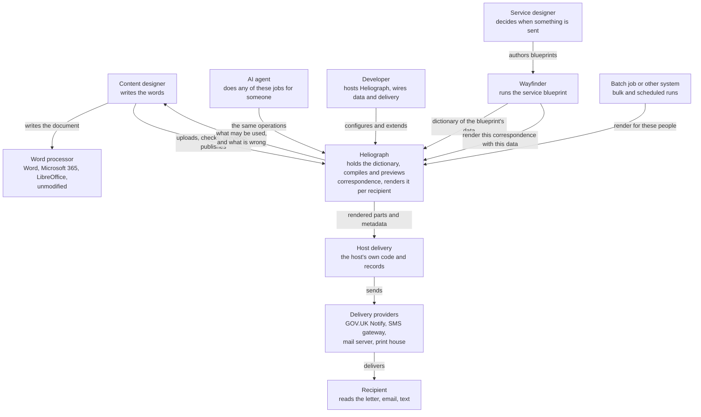
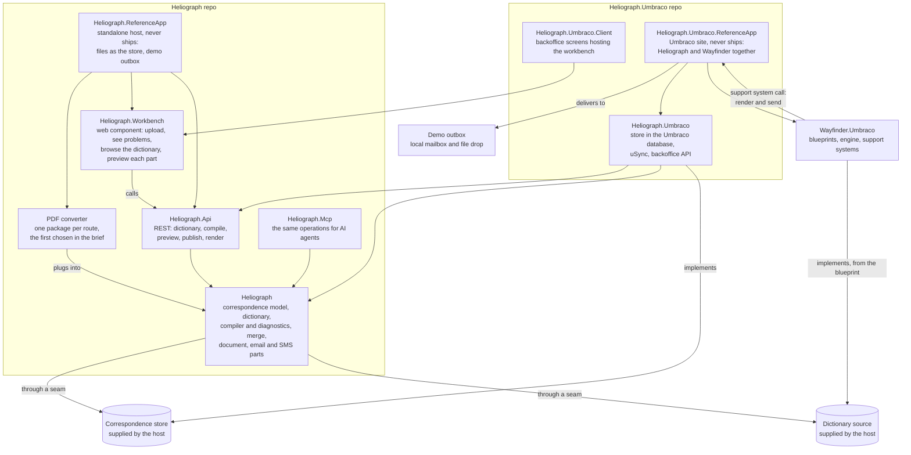
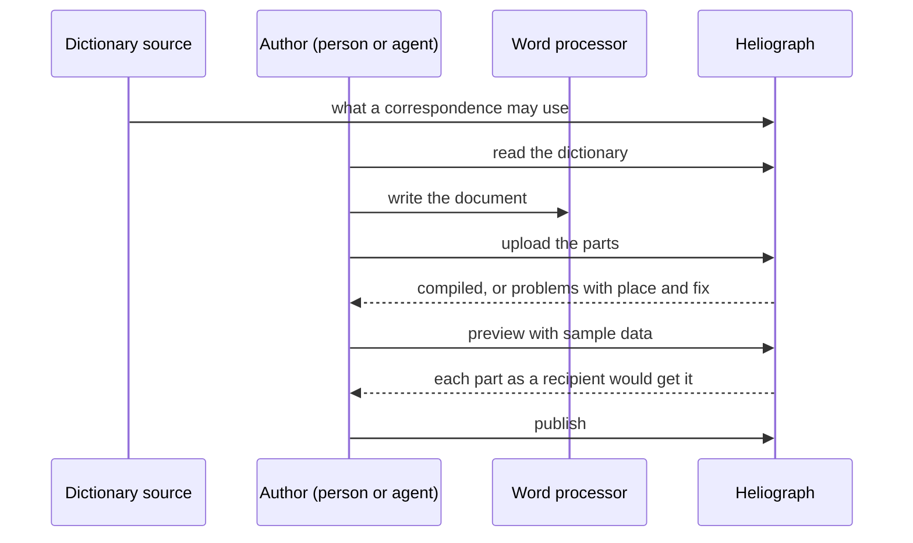
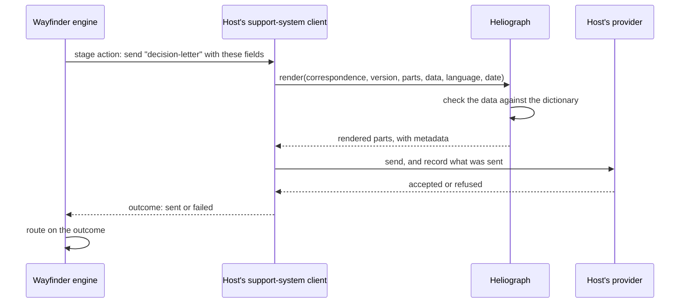

# Architecture

Draft, at the first two levels of the [C4 model](https://c4model.com/): system context (C1) and
containers (C2). It covers both repos: this one, and
[Heliograph.Umbraco](https://github.com/jonnymuir/Heliograph.Umbraco). Nothing below is built yet.
The [brief](brief.md) holds the need, the principles and the decisions still open.

## The shape, in one paragraph

Heliograph follows the model Wayfinder already proved. In Wayfinder a service designer authors a
**blueprint** and an engine runs it. In Heliograph a content designer authors a
**correspondence** and an engine renders it. Both are data, not code, and both are checked before
they can be used. Both ship as an engine that runs anywhere, with a reference host to prove it,
and a separate Umbraco package that hosts it in the backoffice. One thing differs on purpose:
Wayfinder ships an editor for the whole blueprint, and Heliograph does not build a word
processor. Authors write the document in the word processor they already have. The workbench is
where they write the email and the text, and where everything surrounds the document: a
dictionary of what may be used, a compiler that says what is wrong, and a preview.

| | Wayfinder | Heliograph |
|---|---|---|
| Who authors | Service designer | Content designer |
| What they author | Service blueprint | Correspondence: a document, an email and a text |
| Where they author | Wayfinder's editor | Their own word processor |
| What keeps it honest | Blueprint validation | The dictionary and the compiler |
| What the engine does | Runs a journey, one stage at a time | Renders a correspondence for one recipient |
| Standalone proof | `Wayfinder.ReferenceApp` | `Heliograph.ReferenceApp` |
| Umbraco host | `Wayfinder.Umbraco` | `Heliograph.Umbraco` |

## C1: system context

What the picture says:

- **The word processor is outside Heliograph and is not changed.** A file is the only thing that
  passes between them. Anything that works on files (a shared drive, SharePoint, an add-in, a
  browser-based editor) can sit in that gap later without Heliograph depending on it.
- **A person and an agent use the same door.** Reading the dictionary, compiling, previewing and
  publishing are one set of operations, reached through a screen, an API or MCP.
- **The dictionary flows in from whoever knows the data.** For a Wayfinder service it is
  generated from the blueprint, so the two cannot drift.
- **Heliograph never talks to a provider or a recipient.** It hands rendered output back to
  whoever asked. The host sends it and keeps the record of what was sent.
- **Heliograph does not know Wayfinder exists.** Wayfinder reaches it as a
  [support system](https://github.com/jonnymuir/Wayfinder/blob/main/docs/guides/support-systems.md):
  the host registers a capability such as "send correspondence", whose client renders through
  Heliograph, delivers through the host's provider, and resolves an outcome (`sent`, `failed`)
  that the blueprint routes on. A batch job uses the same render call without Wayfinder.

## C2: containers

C4 containers are things that run or store data. For a package product the useful units are the
packages and the hosts that prove them, so that is what is drawn. Names are proposals.

| Container | Ships | Responsibility |
|---|---|---|
| `Heliograph` | NuGet | The correspondence model, the dictionary, the compiler and its diagnostics, merge, and the three first parts: document (`.docx`), email and SMS. No framework reference. |
| PDF converter | NuGet, one per route | Turns a merged document into a PDF. Separate so a host chooses its route, or none, and the core never assumes one. |
| `Heliograph.Api` | NuGet | One `Map...()` call adds REST endpoints for the dictionary, compile, preview, publish and render. The host supplies authorisation. |
| `Heliograph.Mcp` | NuGet | The same operations over MCP, with the guides and the dictionary as resources, so an agent works the way a person does. |
| `Heliograph.Workbench` | NuGet (compiled web component) | The author's screen. Write the email and the text with the dictionary at hand, bring the document in from a word processor and send it back, see what is wrong and where, preview every part with sample data, publish. It does not lay out documents. |
| `Heliograph.ReferenceApp` | Never | Proves the engine runs with no CMS: correspondence as files, an outbox page that shows what would have been sent. Holds the benchmark letters. Also the target for security and performance scans. |
| `Heliograph.Umbraco` | NuGet | Correspondence stored in the Umbraco database and carried between environments by uSync, an API behind backoffice sign-in, wired by a composer. |
| `Heliograph.Umbraco.Client` | Inside `Heliograph.Umbraco` | The backoffice screens, beside Wayfinder's Blueprints. |
| `Heliograph.Umbraco.ReferenceApp` | Never | An Umbraco site with Wayfinder.Umbraco installed, where a blueprint supplies the dictionary, a stage sends a letter by calling Heliograph as a support system, and delivery goes to a local outbox. |

### The seams

Each is an interface in the core with one implementation shipped first. Adding another does not
change the core.

| Seam | First implementation | Could be added |
|---|---|---|
| Part format | `.docx` document, CommonMark email, plain-text SMS | OpenDocument, messaging apps |
| Output conversion | One PDF converter | Another route to PDF, other formats |
| Correspondence store | Files (reference app), Umbraco database | Any database or document library |
| Dictionary source | A file (reference app), a Wayfinder blueprint | Any system that knows its own data |

### The design-time path

### The run-time path

The client in the middle is host code. In the Umbraco reference app it is the worked example of
how to join the two; it does not live in either engine.

## Where the rules bite

- No framework dependency: `Heliograph` and the PDF converters reference neither ASP.NET Core nor
  Umbraco nor Wayfinder. `Heliograph.Api` and `Heliograph.Mcp` are the only packages here that
  reference ASP.NET Core.
- Rendering never sends: no container in the Heliograph repo holds a provider SDK. The reference
  app's outbox is a page and a folder, not a sender.
- Any editor, unmodified: no container installs into, or requires anything of, a word processor.
- Person and agent parity: `Heliograph.Api` and `Heliograph.Mcp` expose the same operations over
  the same core, and return the same diagnostics the workbench shows.
- Deny by default: every `Heliograph.Api` and `Heliograph.Mcp` endpoint requires a policy the host
  supplies. Render takes personal data and preview shows it, so neither is ever anonymous.
- Untrusted uploads: files are inspected in the core before anything else reads them, so every
  host gets the same refusal of macros, embedded objects and remote links.

## Trade-offs accepted

- **Mirroring Wayfinder.** One mental model across the estate and a proven layout to copy,
  against a lot of surface (a workbench, an API, an MCP server and two hosts) before a single
  letter reaches anyone. The build order answers it: the core, the dictionary and the compiler
  first, proved on the benchmark letters in the reference app; the workbench and the Umbraco
  package after.
- **No word processor of our own.** Authors keep the tool they know and Heliograph avoids
  building one, against less control: Heliograph cannot stop a mistake being typed in a document,
  only catch it at compile, and moving the file between the two is a step a person has to take.
  That is why the compiler and its diagnostics are the centre of the design, and why that step
  has to be made as simple as possible. The email and the text are plain text, so the workbench
  edits them itself.
- **A part per channel.** Each part is written for its medium, against wording that can drift
  between them. The shared dictionary and one compile keep the data and the checks the same.
