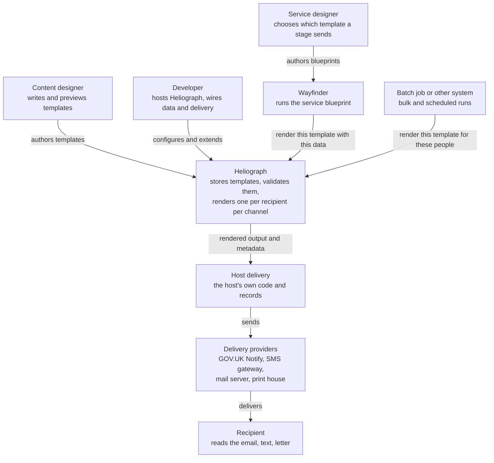
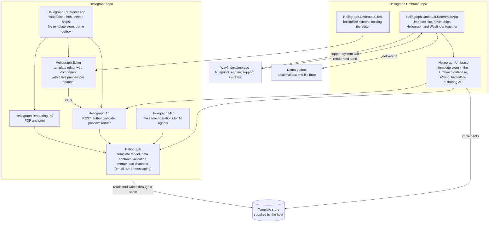
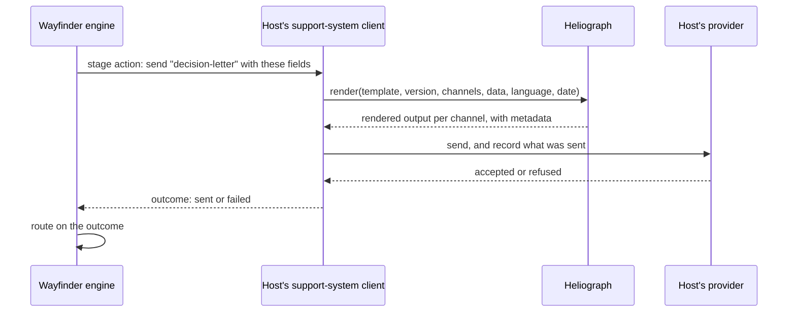

# Architecture

Draft, at the first two levels of the [C4 model](https://c4model.com/): system context (C1) and
containers (C2). It covers both repos: this one, and
[Heliograph.Umbraco](https://github.com/jonnymuir/Heliograph.Umbraco). Nothing below is built yet.
The [brief](brief.md) holds the need and the decisions still open.

## The shape, in one paragraph

Heliograph follows the model Wayfinder already proved. In Wayfinder a service designer authors a
**blueprint** and an engine runs it. In Heliograph a content designer authors a **template** and
an engine renders it. Both are data, not code: authored in a visual editor, stored by the host,
validated before they are saved. Both ship as an engine that runs anywhere, with a reference host
to prove it, and a separate Umbraco package that hosts it in the backoffice. The two meet at run
time: a blueprint stage (or a batch job) asks for a template to be rendered with a person's data,
and the host delivers what comes back.

| | Wayfinder | Heliograph |
|---|---|---|
| Who authors | Service designer | Content designer |
| What they author | Service blueprint | Correspondence template |
| What the engine does | Runs a journey, one stage at a time | Renders a template for one recipient, per channel |
| Standalone proof | `Wayfinder.ReferenceApp` | `Heliograph.ReferenceApp` |
| Umbraco host | `Wayfinder.Umbraco` | `Heliograph.Umbraco` |

## C1: system context

What the picture says:

- **Heliograph never talks to a provider or a recipient.** It hands rendered output back to
  whoever asked. The host sends it and keeps the record of what was sent.
- **Heliograph does not know Wayfinder exists.** Wayfinder reaches it as a
  [support system](https://github.com/jonnymuir/Wayfinder/blob/main/docs/guides/support-systems.md):
  the host registers a capability such as "send correspondence", whose client renders through
  Heliograph, delivers through the host's provider, and resolves an outcome (`sent`, `failed`)
  that the blueprint routes on. A batch job uses the same render call without Wayfinder.
- **A template declares the data it needs.** That declaration is the contract between the two
  designers: the content designer says "this letter needs a name, an address and a decision", and
  the blueprint's bindings are checked against it at design time, the way Wayfinder already
  validates support-system inputs.

## C2: containers

C4 containers are things that run or store data. For a package product the useful units are the
packages and the hosts that prove them, so that is what is drawn. Names are proposals.

| Container | Ships | Responsibility |
|---|---|---|
| `Heliograph` | NuGet | The template model, the data a template declares it needs, validation, merge, and the channels that need no heavy dependency. No framework reference. |
| `Heliograph.Rendering.Pdf` | NuGet | PDF and print output. Separate so a host that only sends email and SMS does not carry a PDF engine. |
| `Heliograph.Api` | NuGet | One `Map...()` call adds REST endpoints for authoring, validation, preview and render. The host supplies authorisation. |
| `Heliograph.Mcp` | NuGet | The same authoring operations over MCP, with the guides as resources, so an agent can write and check templates. |
| `Heliograph.Editor` | NuGet (compiled web component) | Where content designers work: write once, see each channel's output beside it. |
| `Heliograph.ReferenceApp` | Never | Proves the engine runs with no CMS: templates as files, an outbox page that shows what would have been sent. Also the target for security and performance scans. |
| `Heliograph.Umbraco` | NuGet | Templates stored in the Umbraco database and carried between environments by uSync, an authoring API behind backoffice sign-in, wired by a composer. |
| `Heliograph.Umbraco.Client` | Inside `Heliograph.Umbraco` | The backoffice screens, beside Wayfinder's Blueprints. |
| `Heliograph.Umbraco.ReferenceApp` | Never | An Umbraco site with Wayfinder.Umbraco installed, where a blueprint stage sends a letter by calling Heliograph as a support system, and delivery goes to a local outbox. |

### The run-time path through the containers

The client in the middle is host code. In the Umbraco reference app it is the worked example of
how to join the two; it does not live in either engine.

## Where each rule from the repo guide bites

- No framework dependency: `Heliograph` and `Heliograph.Rendering.Pdf` reference neither ASP.NET
  Core nor Umbraco nor Wayfinder. `Heliograph.Api` and `Heliograph.Mcp` are the only packages here
  that reference ASP.NET Core.
- Rendering never sends: no container in the Heliograph repo holds a provider SDK. The reference
  app's outbox is a page and a folder, not a sender.
- Deny by default: every `Heliograph.Api` and `Heliograph.Mcp` endpoint requires a policy the host
  supplies. Render takes personal data and preview shows it, so neither is ever anonymous.

## Trade-off accepted by mirroring Wayfinder

The benefit is one mental model across the estate and a proven layout to copy. The cost is
surface: an editor, an API, an MCP server and two hosts before a single letter reaches anyone. The
build order keeps that honest: the core and one channel first, proved in the reference app with
templates as files; the editor and the Umbraco package only once a rendered message is worth
authoring.

## Decisions this leaves open

They are listed in the [brief](brief.md#open-decisions). The ones this design leans on most:

- The content model (structured blocks or a plain formatting language). Either way it is data.
- Whether the Wayfinder join stays as reference-app code or becomes a small adapter package.
- One support-system capability per template, or one capability that takes the template as an
  input.
